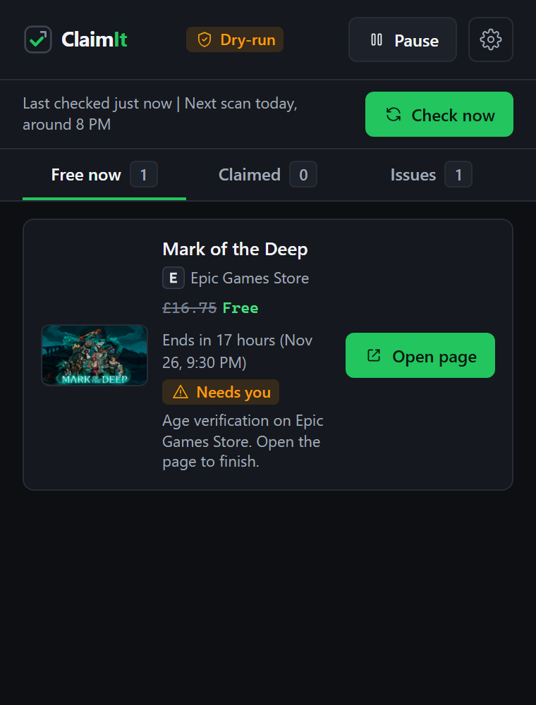
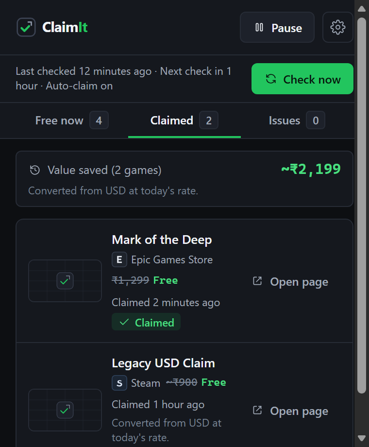
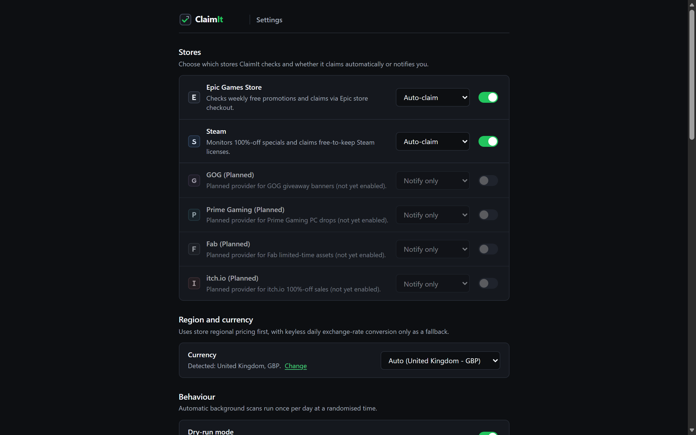
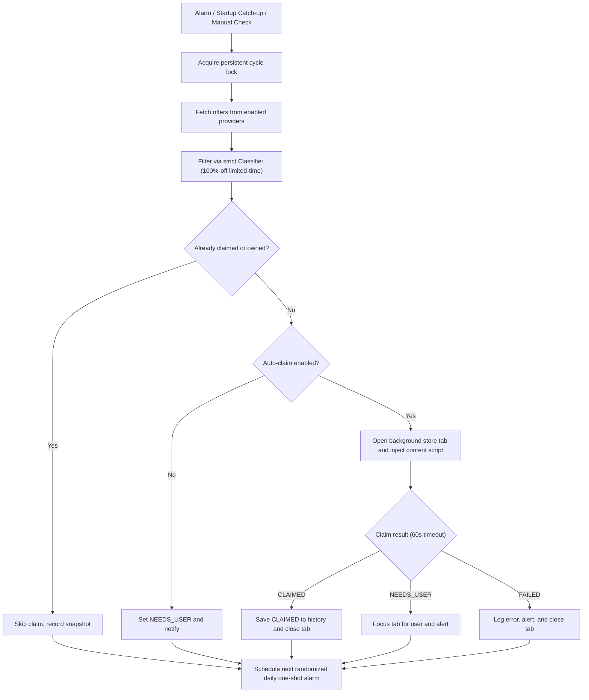

# ClaimIt

ClaimIt is a lightweight Chrome Manifest V3 browser extension written in dependency-free ES modules that monitors Epic Games Store and Steam for limited-time free-to-keep game and DLC promotions, claims eligible offers automatically using your existing logged-in browser session, and alerts you via Chrome notifications, Telegram, or Discord when a promotion requires manual steps such as login confirmation, age verification, or CAPTCHA solving.

## Features

- **Plugin-style store providers**: Active implementations for **Epic Games Store** and **Steam** (with swappable search and community adapters), plus disabled stubs for **GOG**, **Prime Gaming**, **Fab**, and **itch.io**.
- **Strict offer classification**: Claims only limited-time, 100%-off free-to-keep games and DLC (labelled `DLC`). Excludes permanent free-to-play titles, demos, free weekends/trials, partial discounts, and upcoming offers.
- **Session-only automation**: Never asks for, reads, or stores account passwords. Opens claim pages in a background tab using your browser's active session and closes tabs automatically unless user interaction (`NEEDS_USER`) is needed.
- **Once-daily randomized scheduling**: Schedules a single one-shot `chrome.alarms` `when` alarm per day (+18 h to +30 h randomized window, clamped between 12 h and 36 h), pulls earlier with at least 1 hour of safety margin if a known offer expires sooner, and runs a delayed catch-up scan (30-180 s) if scans were missed while Chrome was closed.
- **Region-aware pricing and localization**: Resolves currency in order of user override, detected store currency (`INR`, `USD`, `EUR`, `JPY`, and more), browser locale (`navigator.language`), and `USD` fallback, using a 24-hour cached keyless exchange-rate fallback only when currencies differ.
- **Zero idle background scripts**: Uses no always-on `content_scripts`, no `setInterval` or `setTimeout` scheduling loops, on-demand script injection via `chrome.scripting.executeScript`, a 50-entry capped ring-buffer log, and a 500-entry capped claim history.
- **Multi-channel notifications**: Rich Chrome desktop notifications with cover art and **Claim now** / **Dismiss** buttons, plus optional Telegram Bot and Discord Webhook alerts for `NEEDS_USER` and `FAILED` outcomes.
- **Safety controls**: Instant **Pause** switch, **Dry-run** mode, serialized claims with randomized delays, 60-second per-claim timeout, per-cycle safety claim cap, 5-minute manual check cooldown, and strict URL/schema validation.

## Screenshots

| Free now (status and active offer) | Claimed history and regional savings | Settings and store configuration |
|---|---|---|
|  |  |  |

## How It Works

ClaimIt separates discovery, classification, automation, scheduling, notifications, and storage into small ES modules executed by the Manifest V3 service worker (`src/background.js`):

1. **Providers (`src/providers/`)** fetch public free-promotion feeds for enabled stores and normalize titles, original regional prices, promo dates, and store URLs.
2. **Classifier (`src/classifier.js`)** filters out permanent free-to-play titles, demos, trials/free weekends, partial discounts (<100% off), and upcoming promotions.
3. **Engine (`src/engine.js`)** acquires a persistent cycle lock in `chrome.storage.local`, skips items already claimed or owned, runs up to one claim at a time under a 60-second abort timeout (`src/content/*.js` injected on demand), and isolates errors per store.
4. **Scheduler (`src/scheduler.js`)** records `lastScanAt` and `nextScanAt` and schedules the next single one-shot alarm via `chrome.alarms.create(..., { when })`.
5. **Notifications (`src/notifications.js`)** dispatches deduplicated Chrome notifications (with cached cover art) and optional Telegram/Discord alerts.
6. **Storage (`src/storage.js`)** persists settings, claim history (max 500 entries), offer snapshots, region state, 24-hour FX cache, and a 50-entry debug log locally on device.



## Installation

### Chrome / Brave / Chromium (Developer Mode)

1. Download or clone this repository (`claimit-extension`).
2. Open `chrome://extensions` (or `brave://extensions`).
3. Turn on **Developer mode** in the top-right corner.
4. Click **Load unpacked** and select the `claimit-extension` directory (or unzip `claimit-extension.zip` produced by `npm run build` and select that folder).
5. Sign in to your Epic Games Store and Steam accounts in the same browser profile.

### Chrome Web Store

Chrome Web Store packaging is ready (`npm run build` generates `claimit-extension.zip` containing only runtime files, ~89 KB zipped). A public Chrome Web Store listing link will be added once published.

## Usage and Settings

Click the ClaimIt toolbar icon to inspect **Free now**, **Claimed**, and **Issues**, pause/resume automation, or trigger an on-demand **Check now** (rate-limited to once every 5 minutes). Click the gear icon to open **Settings** (`src/options/options.html`):

- **Stores**: Enable or disable individual stores and choose **Auto-claim** or **Notify only** per store.
- **Region and currency**: Defaults to `Auto` (reads store currency/country, falls back to browser locale, then `USD`), or choose any of 34 supported currencies manually.
- **Behaviour**: Enable **Dry-run mode** to test offer detection and reach the checkout/claim button without clicking the final purchase button.
- **Notifications**: Toggle desktop Chrome notifications and optionally enable Telegram Bot or Discord Webhook alerts for `NEEDS_USER` and `FAILED` outcomes (requests optional host permissions only when enabled or tested).
- **Log and Advanced**: Filter and copy the local 50-entry structured log, configure an optional HTTPS remote `selectors.json` override, or clear local claim history.

## Supported Stores

| Store | Status | Discovery Method | Auto-Claim Behavior |
|---|---|---|---|
| **Epic Games Store** | Active | Public `freeGamesPromotions` JSON endpoint | Opens product tab, handles EU agreement and checkout frame, stops cleanly for login or CAPTCHA |
| **Steam** | Active | Storefront search specials + `appdetails` + `userdata` | Handles birthday age gate, checks library ownership, clicks Add to Account |
| **GOG** | Stub | Not implemented | Disabled stub ready for community/PR implementation |
| **Prime Gaming** | Stub | Not implemented | Disabled stub ready for community/PR implementation |
| **Fab** | Stub | Not implemented | Disabled stub ready for community/PR implementation |
| **itch.io** | Stub | Not implemented | Disabled stub ready for community/PR implementation |

## Permissions

ClaimIt requests the minimum Manifest V3 permissions required:

| Permission | Reason |
|---|---|
| `alarms` | Schedules a single randomized daily one-shot alarm (`{ when }`) and delayed startup catch-up scans. |
| `notifications` | Displays rich notifications with cover art and **Claim now** / **Dismiss** buttons. |
| `storage` | Stores settings, claim history (max 500), offer snapshots, schedule timestamps, notification dedup state, FX cache, and logs (max 50) in `chrome.storage.local`. |
| `scripting` | Inspects frames and injects `src/content/epic.js` or `src/content/steam.js` on demand only into active claim tabs. |
| `tabs` | Opens temporary background tabs for claiming, closes them on completion, and focuses tabs requiring manual user action. |

### Host Permissions

| Origin | Purpose | Required or Optional |
|---|---|---|
| `https://store-site-backend-static-ipv4.ak.epicgames.com/*` | Fetches Epic's public free promotions catalog feed. | Required |
| `https://store.epicgames.com/*` | Reads Epic store pages and triggers product page claim actions. | Required |
| `https://payment-website-pci.ol.epicgames.com/*` | Completes Epic's checkout modal/iframe during auto-claim. | Required |
| `https://store.steampowered.com/*` | Queries free specials search results, `appdetails`, `dynamicstore/userdata/`, and interacts with Steam app pages. | Required |
| `https://raw.githubusercontent.com/*` | Fetches optional user-configured remote `selectors.json` updates. | Optional (requested on click) |
| `https://open.er-api.com/*` | Keyless daily FX rate fallback cached locally for 24 h when converting across currencies. | Optional (requested on override) |
| `https://api.telegram.org/*` | Sends Telegram alerts when configured and enabled by the user. | Optional (requested on enable/test) |
| `https://discord.com/*`, `https://discordapp.com/*` | Sends Discord webhook embeds when configured and enabled by the user. | Optional (requested on enable/test) |
| `https://steamdb.info/*` | Optional swappable SteamDB source adapter if enabled via code/config. | Optional |

## Privacy and Security

- **Local-only data**: All settings, history, region preferences, and logs live exclusively in `chrome.storage.local`. There are no developer servers, analytics, telemetry, or ads.
- **No credential access**: ClaimIt never asks for, reads, or stores store passwords.
- **Strict CSP and DOM hygiene**: Extension pages enforce `script-src 'self'; object-src 'none';` with zero inline scripts, zero `eval`/`Function`, and zero `innerHTML`/`outerHTML`/`insertAdjacentHTML` usage.
- **Allowlists and secret redaction**: Tab/notification URLs are verified against strict store host allowlists, Discord webhooks must match `https://discord[app].com/api/webhooks/...`, remote selector configs are size-capped (512 KB) and schema-validated against explicit key allowlists, and Telegram/Discord tokens are redacted automatically before logging or displaying errors.

See [SECURITY.md](SECURITY.md) for vulnerability reporting and [PRIVACY.md](PRIVACY.md) for full data handling details.

## Limitations and Known Issues

- **Live store pages (`UNVERIFIED` end-to-end)**: Live store selectors and checkout/login redirects depend on third-party HTML and account sessions that cannot be verified automatically offline without a logged-in account; selector rules live in `config/selectors.json` so they can be updated if a store changes layout.
- **CAPTCHAs and manual verification**: ClaimIt never bypasses CAPTCHAs or 2FA/region verification checks; whenever one appears, ClaimIt marks the offer `NEEDS_USER`, brings the tab forward, and notifies you.
- **Browser must open periodically**: Scheduled background checks run only while the browser is running; if Chrome is closed across one or more days, ClaimIt schedules one randomized catch-up scan 30-180 seconds after browser startup.
- **Third-party site changes**: Storefront DOM markup changes on Epic Games Store or Steam can break auto-claim until `config/selectors.json` is updated.

## Terms of Service Notice

ClaimIt automates clicking claim buttons inside your own active browser session. Review the Terms of Service of Epic Games Store, Steam, and any third-party store before enabling automated claiming. You assume full responsibility for how you use browser automation on your accounts, and **Notify only** mode is available per store at any time if you prefer to claim manually.

## Development

### Project Structure

```text
claimit-extension/
├── manifest.json
├── package.json
├── eslint.config.mjs
├── config/
│   └── selectors.json
├── assets/                    # Extension icons, sprites, SVG illustrations
├── docs/images/               # Documentation screenshots
├── scripts/
│   └── build-zip.js           # Pure Node production packager -> claimit-extension.zip
├── src/
│   ├── background.js          # MV3 service worker, alarms, notification click & IPC handlers
│   ├── classifier.js          # Pure free-to-keep offer filter
│   ├── currency.js            # Region detection, FX cache, and Intl formatting
│   ├── engine.js              # Scan cycle runner, cycle lock, safety claim cap, timeouts
│   ├── logger.js              # Secret-redacting 50-entry ring buffer logger
│   ├── notifications.js       # Chrome, Telegram, and Discord dispatchers
│   ├── remote-config.js       # Strict schema validator, size guard & cache for selectors.json
│   ├── scheduler.js           # Once-daily randomized one-shot alarm scheduler
│   ├── storage.js             # chrome.storage.local wrappers & value-saved calculations
│   ├── url-validator.js       # Store URL, endpoint, and Discord webhook validators
│   ├── content/               # On-demand DOM helpers (epic.js, steam.js)
│   ├── providers/             # Store adapters (epic, steam, gog/prime/fab/itch stubs)
│   ├── styles/                # Shared light/dark tokens (tokens.css)
│   ├── ui/                    # SVG icon/illustration mounting & time formatters
│   ├── popup/                 # Toolbar popup UI
│   └── options/               # Extension settings & diagnostics UI
└── tests/                     # Node.js built-in test runner suites (53 tests)
```

### Commands (Node.js 20+)

```bash
npm run lint    # ESLint flat config checks (including service worker timer rules)
npm test        # Runs unit & security test suites via node --test
npm run build   # Packages runtime files cleanly into claimit-extension.zip
```

Manual Chrome/Brave verification steps are documented in [TESTING.md](TESTING.md).

### Adding a New Store Provider

1. Create a provider module in `src/providers/<store>.js` exporting `id`, `name`, `fetchOffers(context)`, `isOwned(offer, context)`, and `claim(offer, context)` (returning `CLAIMED`, `NEEDS_USER`, or `FAILED`).
2. Register it in `src/providers/index.js` and add default settings in `src/storage.js` plus UI helper copy in `src/options/options.js` and `assets/stores.svg`.
3. Add only the minimum required host permission in `manifest.json`, update endpoint/tab allowlists in `src/url-validator.js` and `src/remote-config.js`, and add unit tests in `tests/`.

## Contributing

Issues and pull requests are welcome, especially store selector updates in `config/selectors.json` and implementations for the planned store stubs. Please run `npm run lint` and `npm test` before submitting changes, and avoid introducing emojis or runtime dependencies.

## License

Licensed under the [MIT License](LICENSE).

## Acknowledgements

- [ExchangeRate-API Open Access](https://www.exchangerate-api.com/docs/free) for keyless daily JSON exchange-rate data used only when cross-currency fallback conversion is needed.
- [ESLint](https://eslint.org/) (development-only dependency) for static checks and service-worker timer rules.
