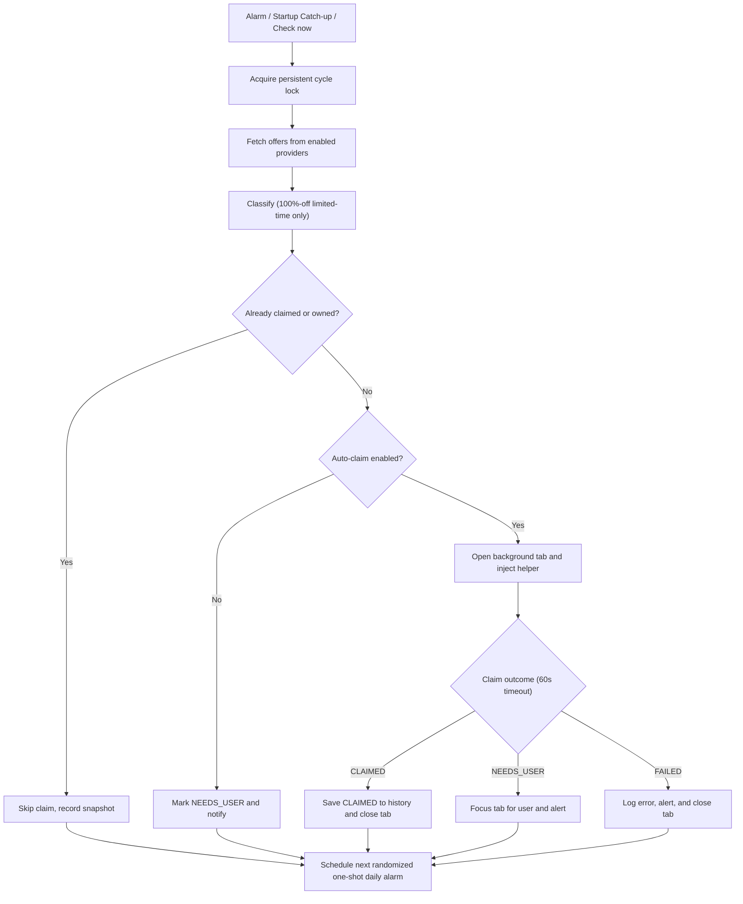

# Developer Notes (Internal)

These are internal engineering notes for the author's maintenance of ClaimIt. This repository is shared solely for public viewing and personal, non-commercial use of the unmodified extension under [LICENSE](../LICENSE); modification and redistribution require written permission.

## Architecture Overview

ClaimIt runs as a Chrome Manifest V3 extension (`src/background.js` module service worker) with zero runtime dependencies and zero build compilation step:

1. **Providers (`src/providers/`)** fetch public free-promotion endpoints (`epic.js`, `steam.js`), paginate Steam's **Deals** (`specials=1`) and **Free Steam** (`maxprice=free`) catalogs with review parsing and search, or serve as disabled stubs (`gog.js`, `prime-gaming.js`, `fab.js`, `itch.js`).
2. **Classifier (`src/classifier.js`)** accepts only limited-time, 100%-off free-to-keep titles and DLC (tagged `DLC`) for auto-claiming, rejecting permanent free-to-play games, demos, trials/weekends, partial discounts, and upcoming promotions.
3. **Engine (`src/engine.js`)** acquires a storage cycle lock (`claimit_cycle_lock`), enforces a safety cap (`MAX_CLAIMS_PER_CYCLE = 20`) and serialized 60-second claim timeout, isolates provider failures, and manages rotating batch offsets for Deals and Free Steam.
4. **Scheduler (`src/scheduler.js`)** sets one randomized one-shot `chrome.alarms` `{ when }` alarm per day (`12h` to `36h` bounds around `24h`, pulled earlier if an offer expires soon) plus a `30-180 s` startup catch-up alarm when browser downtime misses a scan (install triggers an immediate first check).
5. **Currency & Notifications (`src/currency.js`, `src/notifications.js`)** resolve store/locale currency (`Auto` or explicit currency), fetch 24h FX fallback rates from `open.er-api.com` when needed, deduplicate notifications per cycle, and optionally send Telegram/Discord alerts.
6. **Security & Validation (`src/url-validator.js`, `src/remote-config.js`, `src/logger.js`)** enforce store URL allowlists, Epic/Steam CDN image allowlists (`isAllowedImageUrl`), Discord webhook path checks, schema/size validation on remote `selectors.json`, `sender.id` IPC checks, and token redaction across the 50-entry log ring buffer.



## Project Structure

```text
claimit-extension/
├── manifest.json              # MV3 manifest, strict CSP, required & optional hosts
├── package.json               # lint, test, and build scripts (ESLint dev-only)
├── eslint.config.mjs          # Flat ESLint config + service worker timer restrictions
├── config/
│   └── selectors.json         # Bundled endpoints, DOM selectors, and button text matchers
├── assets/                    # Extension icons, sprites, SVG illustrations
├── docs/
│   ├── DEVELOPMENT.md         # Internal engineering notes (this file)
│   └── images/                # Documentation screenshots
├── scripts/
│   └── build-zip.js           # Pure Node packager -> claimit-extension.zip (42 runtime files)
├── src/
│   ├── accounts.js            # One-click store Sign in tab tracking & session checks
│   ├── background.js          # Service worker, alarms, notification clicks, IPC
│   ├── classifier.js          # Pure free-to-keep offer filter
│   ├── currency.js            # Region detection, FX cache, Intl formatters
│   ├── engine.js              # Cycle orchestrator, lock, timeouts, safety cap
│   ├── logger.js              # Secret-redacting 50-entry ring buffer logger
│   ├── notifications.js       # Chrome, Telegram, and Discord dispatchers
│   ├── remote-config.js       # Strict schema & 512 KB validator + cache
│   ├── scheduler.js           # Once-daily randomized one-shot alarm scheduler
│   ├── storage.js             # chrome.storage.local access & value-saved calculations
│   ├── url-validator.js       # Allowlists for store URLs, endpoints, Discord webhooks
│   ├── content/               # On-demand injected helpers (epic.js, steam.js)
│   ├── providers/             # Store adapters + tab/frame messaging helpers
│   ├── styles/                # Shared light/dark CSS tokens (tokens.css)
│   ├── ui/                    # SVG helpers and Intl time formatters
│   ├── popup/                 # Toolbar popup UI
│   └── options/               # Options & log viewer page
└── tests/                     # Node.js built-in test runner suites (66 tests)
```

## Local Commands

Verified on Node.js v24.19.0 (compatible with Node.js 20+):

```bash
npm run lint    # ESLint static checks and worker timer guardrails
npm test        # Runs tests/*.test.js via node --test (66 unit & security tests)
npm run build   # Builds runtime-only claimit-extension.zip (~106.0 KB zipped)
```

Manual browser verification steps (loading unpacked, inspecting service worker logs, and verifying dry-run notifications) are in [TESTING.md](../TESTING.md).

## Adding a Store Provider (Author Checklist)

1. Implement `src/providers/<store>.js` exporting `id`, `name`, `fetchOffers(context)`, `isOwned(offer, context)`, and `claim(offer, context)` (returning `CLAIMED`, `NEEDS_USER`, or `FAILED`).
2. Register the module in `src/providers/index.js`, add default store config in `src/storage.js`, add store helper text in `src/options/options.js`, and add the store icon symbol in `assets/stores.svg`.
3. Add only minimum origins in `manifest.json`, update host allowlists in `src/url-validator.js` and `src/remote-config.js`, and add unit tests under `tests/`.
